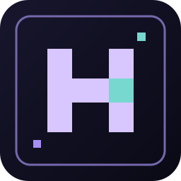

  
  

    
    
    
  

<table><tr><td width="68" valign="middle"></td><td valign="middle">
<b>AI Sciences graduate, based in Riyadh.</b> 
I work across machine learning, generative AI, and multimodal systems. From KACST research to building products and experimenting with the engineering behind AI. Currently strengthening my backend and data foundations.
</td></tr></table>

## Selected work

<table>
<tr>
<td width="50%" valign="top">
  
  <h3><a href="./work/eeg-to-text.md">EEG-to-Text · KACST ↗</a></h3>
  Exploring spatial, spectral, and language factors in EEG decoding. Presented at ICDR 2026.  
   
  EEG · Deep Learning · LLMs · Research
</td>
<td width="50%" valign="top">
  
  <h3><a href="./work/emora.md">Emora ↗</a></h3>
  Graduation team project connecting EEG, gaze, emotion recognition and Arabic creative generation.  
   
  Multimodal AI · GenAI · SDXL · Gemini
</td>
</tr>
<tr>
<td width="50%" valign="top">
  
  <h3><a href="https://github.com/Heaikyoraku/Booking-agent">Booking Agent ↗</a></h3>
  Agentic AI bootcamp team demo for conversational event booking, distinct from my independent rebuild.  
   
  AI Agents · APIs · SQL · Booking Flows
</td>
<td width="50%" valign="top">
  
  <h3><a href="https://github.com/Heaikyoraku/Emotion2Art_Pipeline">Emotion2Art ↗</a></h3>
  Text emotion recognition paired with diffusion-based image generation and a Gradio interface.  
   
  DistilBERT · Hugging Face · Stable Diffusion
</td>
</tr>
<tr>
<td width="50%" valign="top">
  
  <h3><a href="https://github.com/Heaikyoraku/ArtifyAI">ArtifyAI ↗</a></h3>
  Collaborative vision project combining image restoration and guided generative stylization.  
   
  CodeFormer · CLIP · ControlNet
</td>
<td width="50%" valign="top">
  
  <h3><a href="https://github.com/Heaikyoraku/Insiyab">Insiyab ↗</a></h3>
  Natural-language metro congestion prototype, built on synthetic Riyadh Metro data.  
   
  NLP · LSTM · Data Analysis · Gradio
</td>
</tr>
</table>

## Tools I use

  
  

    
    
    
    
    
  

  Also working with SQL, pandas, NumPy, computer vision and LLM APIs. Exploring Databricks, deeper data systems and MLOps.

<b>＋ Other projects & experiments</b>

| Work | Focus |
| :--- | :--- |
| [Dhallaty](./work/dhallaty.md) | AI product · Computer Vision · Startup / CTO |
| [EasePark](./work/easepark.md) | Smart Parking · Arduino · IoT |
| [National Happiness Prediction](https://github.com/Heaikyoraku/National-Happiness-Prediction) | EDA · Regression · Model Comparison |
| [AI for Cybersecurity](./work/cybersecurity-ml.md) | ML · Feature Selection · Classification |
| [Industrial Analytics](./work/industrial-analytics.md) | IIoT · OEE · Data Analysis |

### On the workbench

**Agentic Event Booking Platform** — independently rebuilding the bootcamp booking idea to strengthen database design, backend services, testing and agent workflows.

**[Agent Content Writer](./work/agent-content-writer.md)** — private project turning GitHub activity into Arabic content drafts with Python, Claude API, Docker and GitHub Actions.

Research and team work are presented as such. Code and data from KACST are not published here.