  
  

    
    
    
  

  

### > ABOUT

AI Engineer in Riyadh, Saudi Arabia. My work spans **applied machine learning, generative and multimodal systems, research, and AI-powered products** — from EEG decoding experiments at KACST to building startup and software prototypes.

### > TECH STACK

  
  
Python · PyTorch · TensorFlow · scikit-learn · SQL/PostgreSQL · FastAPI · Docker · Git/GitHub Actions

### > AI TOOLING

  
  
  
  
  
Exploring: Codex · Claude Code · Databricks · production MLOps

### > FEATURED PROJECTS

<table>
<tr>
<td width="50%" valign="top">
  <a href="./work/emora.md"><b>EMORA ↗</b></a> 
  Multimodal emotion recognition + Arabic generative storytelling. Graduation project.  
   
  <b>EEG</b> · Eye Tracking · Multimodal ML · SDXL · Gemini
</td>
<td width="50%" valign="top">
  <a href="./work/eeg-to-text.md"><b>EEG-TO-TEXT RESEARCH ↗</b></a> 
  Spatial, frequency and Arabic-language investigations. KACST / ICDR 2026.  
   
  <b>EEG</b> · Deep Learning · LLMs · Signal Analysis
</td>
</tr>
<tr>
<td width="50%" valign="top">
  <a href="https://github.com/Heaikyoraku/Emotion2Art_Pipeline"><b>EMOTION2ART ↗</b></a> 
  Fine-tuned emotion classifier connected to diffusion-based image generation.  
   
  <b>DistilBERT</b> · Hugging Face · Stable Diffusion · Gradio
</td>
<td width="50%" valign="top">
  <a href="https://github.com/Heaikyoraku/Booking-agent"><b>BOOKING AGENT ↗</b></a> 
  SDA Agentic AI bootcamp <b>team</b> project: conversational ticket-booking demo.  
   
  <b>AI Agents</b> · FastAPI · SQLAlchemy · Booking Flows
</td>
</tr>
<tr>
<td width="50%" valign="top">
  <a href="https://github.com/Heaikyoraku/ArtifyAI"><b>ARTIFYAI ↗</b></a> 
  Image restoration and controlled generative stylization. Collaborative project.  
   
  <b>CodeFormer</b> · CLIP · ControlNet · Diffusion
</td>
<td width="50%" valign="top">
  <a href="https://github.com/Heaikyoraku/Insiyab"><b>INSIYAB ↗</b></a> 
  Conversational Riyadh Metro crowding prediction prototype using simulated data.  
   
  <b>NLP</b> · LSTM · Data Analytics · Gradio
</td>
</tr>
</table>

<b>▸ MORE BUILDS & EXPERIMENTS</b>

 
<table>
<tr><td><a href="https://github.com/Heaikyoraku/National-Happiness-Prediction"><b>National Happiness Prediction</b></a></td><td>Python · pandas · scikit-learn · Regression</td></tr>
<tr><td><a href="./work/dhallaty.md"><b>Dhallaty</b></a></td><td>AI Product · Computer Vision · Startup Engineering</td></tr>
<tr><td><a href="./work/easepark.md"><b>EasePark / Smart Parking</b></a></td><td>Arduino · IoT · Sensors · Embedded Prototype</td></tr>
<tr><td><a href="https://github.com/Heaikyoraku/hessah-portfolio"><b>Portfolio Web Experiment</b></a></td><td>Next.js · TypeScript · React</td></tr>
<tr><td><a href="./work/cybersecurity-ml.md"><b>AI for Cybersecurity</b></a></td><td>ML · Feature Selection · Data Preprocessing</td></tr>
<tr><td><a href="./work/industrial-analytics.md"><b>Smart Manufacturing Analytics</b></a></td><td>Industrial Data · OEE · Analytics</td></tr>
</table>

### > CURRENTLY BUILDING

<table>
<tr>
<td width="50%" valign="top">
  <b>AGENTIC EVENT BOOKING PLATFORM</b> 
  Independent engineering rebuild of the event-booking idea — separate from the SDA team demo.  
   
  Backend · Transactions · SQL · Testing · Agents
</td>
<td width="50%" valign="top">
  <a href="./work/agent-content-writer.md"><b>AGENT CONTENT WRITER ↗</b></a> 
  Private workbench for GitHub-activity-driven Arabic content drafts.  
   
  API Integration · Claude · GitHub Actions · Automation
</td>
</tr>
</table>

Riyadh, Saudi Arabia · <a href="https://github.com/Heaikyoraku?tab=repositories">Browse repositories</a>
